<!--
Conventions:
- Every set of clicks goes in a step box: ::: callout-note with a "## Where: what" title
  ("In SPSS: ...", "In the VCL: ...", "In your browser: ..."). Explanations and results stay
  outside the boxes, as plain text.
- After the steps, only "Gotcha: ..." (callout-warning) and "Extra: ..." (callout-tip) callouts.
- Questions for the room are blockquotes.
- [text]{.tbd} marks anything not yet known; ::: {.placeholder} marks a picture still to take.
  Neither should appear in a released version.
- Source: sources/Shortened Fall 2026 SPSS Walkthrough.docx. Changes from it are logged in
  planning/session-outline.md.
-->

::: callout-important
## How to use this guide

This is the page we work from in the session. Every step is written out, so you can follow along,
catch up if you fall behind, and come back to it later.

- **Steps are in blue boxes** titled with where you do them: *In your browser*, *In the VCL* or
  *In SPSS*. Everything outside a box explains what the steps do and how to read the results.
- **The codebook is in @sec-codebook.** Links marked **↑** or **↓** jump to a variable's row in
  it, and each row links on to the places we use that variable.
- **Have your phone ready.** You'll confirm your NC State login with Duo more than once.
- This guide is online at
  [ncsu-libraries.github.io/intro-spss](https://ncsu-libraries.github.io/intro-spss/).
:::

# Welcome {.unnumbered}

## What you'll be able to do {.unnumbered}

- Recognize when to use the Virtual Computing Lab (VCL).
- Justify good data storage strategies.
- Inspect the details about variables within a dataset to ensure good quality analysis.
- Explore SPSS software for statistical data analysis.

## Agenda {.unnumbered}

1. Access SPSS through the VCL (@sec-access).
2. Download the dataset and its codebook within the VCL, and read the codebook
   (@sec-codebook). Normally you would download outside the VCL, but we shortcut a step here for
   time's sake.
3. Open SPSS and review its interface.
4. Examine the dataset: variable types, measurement levels, missing values and value labels
   (@sec-variables).
5. Run descriptive statistics and make graphs: a bar chart, a histogram and a crosstab
   (@sec-descriptive).
6. Run inferential tests: a correlation, a one-way ANOVA and a simple linear regression
   (@sec-inferential). T-tests and normality checks are in the [Appendix](#sec-appendix).
7. Export results (@sec-export).
8. Store exports in cloud storage and exit the VCL. We may not practice this in class.

------------------------------------------------------------------------

# Student access to SPSS {#sec-access}

SPSS is [not available for personal computer download](https://www.lib.ncsu.edu/software/spss)
for students. The best ways to access it are:

1. **Using the [Virtual Computing Lab](https://vcl.ncsu.edu/scheduling) (VCL).**
2. Locally, at Hill Library's Data Experience Lab or Hunt Library's Dataspace computers. To
   reserve one, select **Data Workstation** at [rooms.lib.ncsu.edu](https://rooms.lib.ncsu.edu).
3. At a [Unity Computer Lab](https://ncsu.service-now.com/sp?id=kb_article_view&sysparm_article=KB0022523).

We focus today on setting up and using the VCL for SPSS.

## SPSS access via the VCL

::: placeholder
**Screenshot to take: `images/vcl-new-reservation.png`.** The VCL New Reservation dialog with
"SPSS/AMOS (AVD)" selected in the dropdown and the Connect button visible.
:::

::: callout-note
## In your browser: reserve SPSS in the VCL

1. Go to [vcl.ncsu.edu/scheduling](https://vcl.ncsu.edu/scheduling/).
2. Select the **NCSU Login** authentication method and click **Proceed to Login**. Log in with
   your Unity ID (you will need to Duo authenticate).
3. Click the **Reservations** tab in the header, then the **New Reservation** button.
4. Select **SPSS/AMOS (AVD)** from the dropdown.
5. Click **Connect**.
6. Click **Open the AVD Portal**.
7. Pick an account (select your NC State email address) and enter your password. Duo
   authenticate again if asked.
8. Click **Yes** to stay signed in.
:::

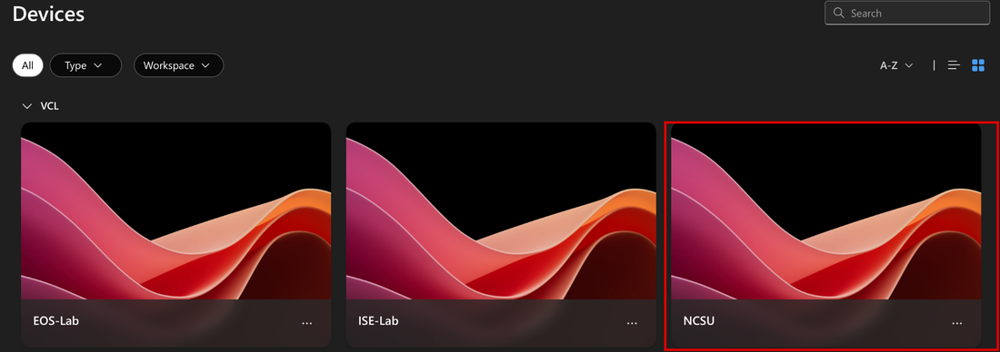{fig-alt="A dark web page titled Devices, with a VCL group of three tiles: EOS-Lab, ISE-Lab and NCSU. A red box outlines the NCSU tile."}

::: callout-note
## In the VCL: open the NCSU desktop and start SPSS

1. Click the **NCSU** computer icon.
2. Select **Connect**.
3. Enter your Unity ID and password to sign in.
4. Click **OK** to acknowledge the folder where you'll save your work.
5. Now you're in the VCL! Wait for it to load.
6. Open **IBM SPSS Statistics** from the desktop. You may notice a little lag between clicks at
   first. While the software is opening, move on to the next section.
:::

{fig-alt="A Windows desktop inside a browser window labeled NCSU, with two columns of shortcut icons on the left. A red box outlines the IBM SPSS Statistics icon, a white sigma on a black square."}

## Download the sample data and codebook

We will be using a sample file from ABC Insurance's employee survey: one row per employee, with
their demographics, job role, tenure, salary, performance evaluation and survey answers. It's a
teaching dataset from [SAGE Research Methods Datasets](#sec-references). The
**codebook** (or data dictionary) tells you what each variable means and how its values are coded.
It's also in this guide, in @sec-codebook.

::: callout-note
## In the VCL: download the files

1. In the VCL, open a web browser and go to this guide:
   [ncsu-libraries.github.io/intro-spss](https://ncsu-libraries.github.io/intro-spss/).
2. Click these links to download the data file and its codebook:
   [TeachingData.sav](https://github.com/NCSU-Libraries/intro-spss/raw/main/data/TeachingData.sav)
   and [SPSS Codebook.xlsx](https://github.com/NCSU-Libraries/intro-spss/raw/main/data/SPSS%20Codebook.xlsx).
3. Notice the data file is named **TeachingData.sav** and the codebook is named
   **SPSS Codebook**.
4. Open **File Explorer** and make sure you can find where the dataset and codebook were
   downloaded. Most likely they're in the Downloads folder of your VCL login:
   **This PC > C: > Users > [your Unity ID] > Downloads**.
:::

::: placeholder
**Screenshot to take: `images/data-file-explorer.png`.** File Explorer in the VCL, open at
This PC > C: > Users > [Unity ID] > Downloads, showing TeachingData.sav and SPSS Codebook.
:::

::: {.callout-warning}
## Gotcha: the VCL doesn't keep your files

Your data can't be reached from your own computer, because the VCL is a separate machine you've
connected to. For the sake of time we download the data within the VCL. When you leave the VCL,
save your data and any result files in cloud storage, such as Google Drive, because the VCL
often clears out files stored on it.
:::

## Load your data

::: callout-note
## In SPSS: open TeachingData.sav

1. In SPSS, go to **File > Open > Data**.
2. In the dropdown next to **Look in**, go to where you saved the file
   (**This PC > C: > Users > [your Unity ID] > Downloads**).
3. Select **TeachingData.sav**. The **File name** box fills in with TeachingData.sav.
4. Click **Open**. The file loads in the SPSS Data Editor.
:::

::: placeholder
**Screenshot to take: `images/data-open-dialog.png`.** SPSS's Open Data dialog, Look in set to
the Downloads folder, with TeachingData.sav selected.
:::

Before you analyze anything, read the codebook (@sec-codebook). Then, in @sec-variables, we
review an important practice: when you import data, always double-check that the data types are
correct.

------------------------------------------------------------------------

# The codebook {#sec-codebook}

A **codebook** (or data dictionary) describes every variable in a dataset: its name, its type,
what it means, how its values are coded and how it is measured. It's how you know that a 2 in
Gender means Male, or that 99 in Evaluation means "no evaluation". Check it before you trust
anything SPSS shows you.

This is the codebook for TeachingData.sav, the same as
[SPSS Codebook.xlsx](https://github.com/NCSU-Libraries/intro-spss/raw/main/data/SPSS%20Codebook.xlsx).
All nine variables are Numeric. The last column links down to where we use each variable, and
**↑** links later in the guide bring you back to its row here.

| Variable | Label | Values | Measure | Where we use it |
|------------|------------------------------|--------------------------|---------|----------------|
| [Ethnicity]{#cb-ethnicity} | Refers to the employee's ethnicity. In order to meet diversity objectives, ABC Insurance Co. is mandated to report five ethnic categories. | 0 = White 1 = Black 2 = Asian 3 = Latino 4 = Other | Nominal | Not used today |
| [Gender]{#cb-gender} | Refers to the employee's gender. | 1 = Female 2 = Male | Nominal | [Reviewing variables](#sec-variables) ↓ [Crosstab](#sec-crosstabs) ↓ [Independent t test](#sec-ttest) ↓ |
| [JobRole]{#cb-jobrole} | Refers to the employee's current position category within ABC Insurance company. This is a fluid variable that changes when the employee changes their job role. | 0 = administrative 1 = customer service 2 = coordinator 3 = junior account manager 4 = senior account manager 5 = assistant branch manager 6 = branch manager 7 = executive | Ordinal | [Crosstab](#sec-crosstabs) ↓ [One-way ANOVA](#sec-anova) ↓ |
| [Age]{#cb-age} | Is simply the current age of the employee, recorded in years. | Missing values are coded as "." | Scale | [Missing values](#sec-missing) ↓ |
| [Tenure]{#cb-tenure} | Refers to the number of years the employee has worked with ABC Insurance company. This is measured in years, rounded up. | | Scale | [Histogram](#sec-freq-scale) ↓ [Correlation](#sec-correlation) ↓ [Regression](#sec-regression) ↓ [Independent t test](#sec-ttest) ↓ [One-sample t test](#sec-onesample) ↓ |
| [SalaryContinuous]{#cb-salarycontinuous} | Refers to employee's annual salary, capturing the employee's specific annual salary. | | Scale | [Correlation](#sec-correlation) ↓ [One-way ANOVA](#sec-anova) ↓ [Regression](#sec-regression) ↓ [Normality check](#sec-normality) ↓ |
| [Evaluation]{#cb-evaluation} | A confidential score assigned to an employee based on their previous year's (or most recent) performance evaluation by their respective supervisor. | 1 = poor 2 = slightly underperformed 3 = met expectations 4 = slightly exceeded expectations 5 = excellent Missing values are coded as "99" | Ordinal | [Reviewing variables](#sec-variables) ↓ [Missing values](#sec-missing) ↓ [Value labels](#sec-values) ↓ [Bar chart](#sec-freq-cat) ↓ |
| [IntentiontoQuit]{#cb-intentiontoquit} | The likelihood/probability that an employee will search for another position (actively) over the next 12 months. | 1 = extremely unlikely 2 = somewhat likely 3 = not sure 4 = somewhat unlikely 5 = extremely likely | Ordinal | Not used today |
| [JobSatisfaction]{#cb-jobsatisfaction} | Measuring how satisfied employees currently are working at ABC Insurance Co. | 1 = extremely unsatisfied 2 = somewhat unsatisfied 3 = neither satisfied nor dissatisfied 4 = somewhat satisfied 5 = extremely satisfied | Ordinal | Not used today |

: The codebook for TeachingData.sav. {.codebook}

> Compare the Measure column here with what SPSS shows in @sec-variables. Do they agree?

------------------------------------------------------------------------

# Reviewing variables {#sec-variables}

The **Variable View** tab is not your data; it's metadata about your data. Review your data in
this tab before doing any analysis, to make sure SPSS read your data in correctly and that you
understand the variables you are working with. Compare what you see with the
[codebook ↑](#sec-codebook).

::: callout-note
## In SPSS: open Variable View

1. Click the **Variable View** tab at the bottom of the Data Editor.
:::

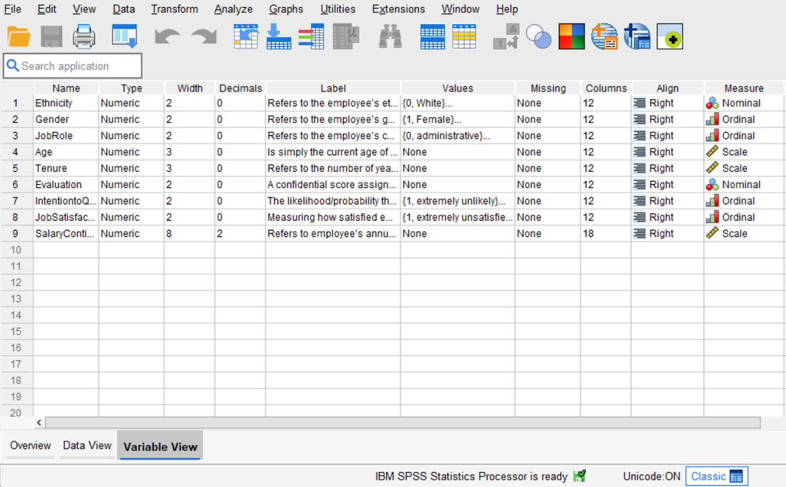{fig-alt="The SPSS Data Editor in Variable View. Nine rows list the variables Ethnicity, Gender, JobRole, Age, Tenure, Evaluation, IntentiontoQuit, JobSatisfaction and SalaryContinuous, with columns Name, Type, Width, Decimals, Label, Values, Missing, Columns, Align and Measure. Gender's Measure is Ordinal and Evaluation's is Nominal."}

What the columns mean:

- **Name** is the machine-readable variable name, like a column heading in a spreadsheet.
- **Type** is how the variable is formatted in the system. Numeric, Date and String are common
  types.
- **Label** is the human-readable label to use in output. It describes the variable.
- **Values** lists the levels for a nominal or ordinal variable. Click the **…** in a cell to
  see the levels defined for that variable.
- **Missing** lets you set the codes used for missing values.
- **Measure** tells you how SPSS is treating the variable:
  - **Nominal**: a categorical variable with a set number of groups.
  - **Ordinal**: a categorical variable with a low-to-high order.
  - **Scale**: a continuous variable.

> After reviewing the variables in Variable View, you might notice it can be improved. What are
> some things you find problematic?

You can edit any of these settings. For example, if a variable has been wrongly identified as
Nominal, you can select the correct Measure from the dropdown. The codebook says Gender is
Nominal ([codebook ↑](#cb-gender)) and Evaluation is Ordinal ([codebook ↑](#cb-evaluation)), but SPSS has them the
other way around.

::: callout-note
## In SPSS: fix the measurement levels

1. In the **Measure** column, change **Gender** from Ordinal to **Nominal**.
2. Change **Evaluation** from Nominal to **Ordinal**.
:::

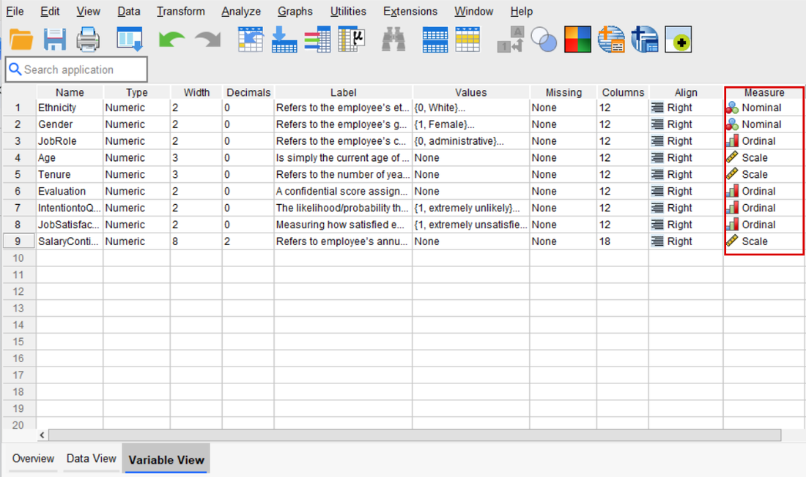{fig-alt="Variable View with a red box around the Measure column. Ethnicity and Gender are Nominal; JobRole, Evaluation, IntentiontoQuit and JobSatisfaction are Ordinal; Age, Tenure and SalaryContinuous are Scale."}

## Coding missing values {#sec-missing}

In **Data View**, a "." in a cell means the value is already coded as *system-missing*, and you
don't have to do anything; Age has some ([codebook ↑](#cb-age)). But some datasets use a number as a missing-value code instead. In
the codebook, Evaluation's values are defined from 1 to 5 ([codebook ↑](#cb-evaluation)), yet some rows have **99**. Those
99s are missing values. Unless you tell SPSS so, it treats 99 as a real score and includes it in
your analysis.

::: placeholder
**Screenshot to take: `images/missing-99-data-view.png`.** Data View scrolled so the
Evaluation column shows a few 99 values among the 1–5 scores (and, if possible, a "." in Age).
:::

::: callout-note
## In SPSS: code 99 as missing

1. Go to the **Data View** tab and look through each variable for missing data. Look at the
   **Evaluation** variable: alongside 1–5, there are rows with 99.
2. Go to the **Variable View** tab and click the **Missing** cell for Evaluation.
3. Click the **…** button. We have one discrete missing value, 99, so click
   **Discrete missing values**.
4. Type **99** in the first box and click **OK**.
:::

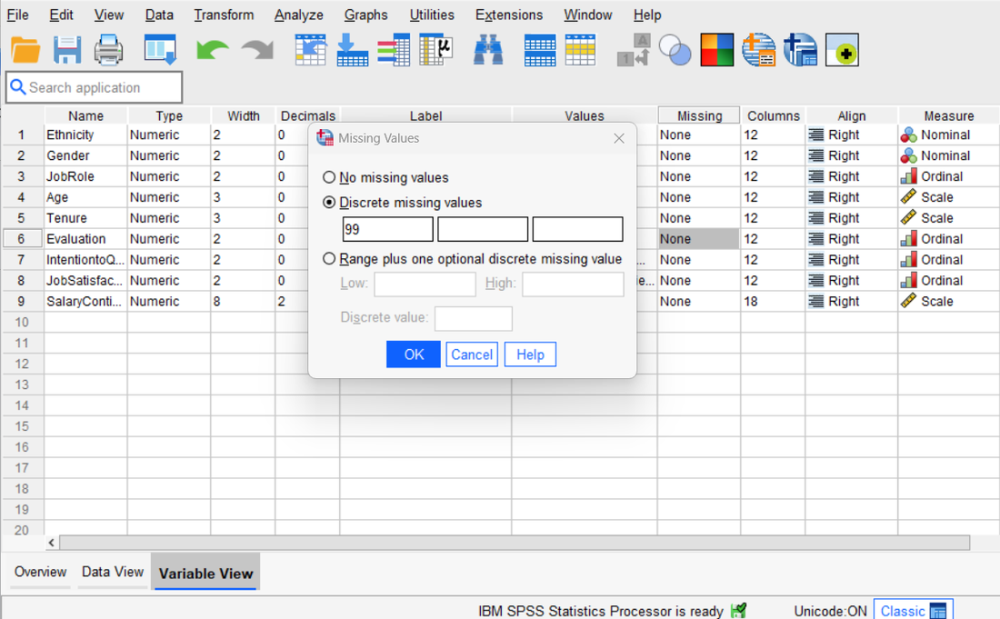{fig-alt="The Missing Values dialog open over Variable View, with Evaluation's Missing cell selected. Discrete missing values is chosen, and the first of three boxes holds 99. Below are OK, Cancel and Help buttons."}

You can set more than one missing code per variable, but usually you only need one. Doing this
keeps those values out of your analysis.

To double-check the missing-value coding, we look at frequencies. First, a setting that makes
SPSS's dialogs easier to use: by default, the variable lists show each variable's long Label, not
its Name.

::: callout-note
## In SPSS: show variable names in dialogs

1. Go to **Edit > Options**, and on the **General** tab, under **Variable Lists**, select
   **Display names**.
2. Click **OK**. If SPSS shows a message about the change, click **OK** again.
:::

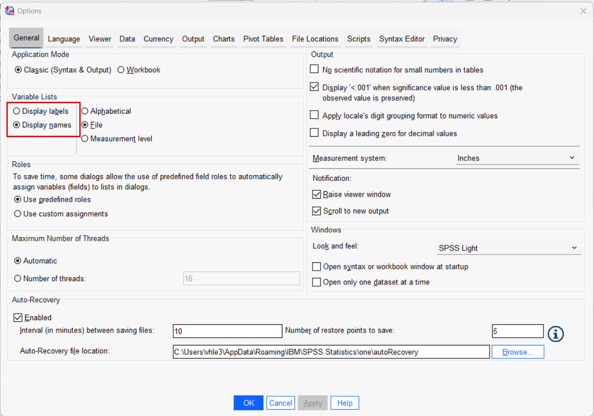{fig-alt="The SPSS Options dialog on the General tab. A red box outlines the Variable Lists options Display labels and Display names, with Display names selected."}

::: callout-note
## In SPSS: check the missing count

1. Click **Analyze > Descriptive Statistics > Frequencies**.
2. Move **Evaluation** into the **Variable(s)** box on the right.
3. Click **OK**.
:::

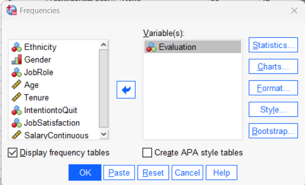{fig-alt="The Frequencies dialog. The variable list on the left shows names such as Ethnicity, Gender and JobRole; Evaluation is in the Variable(s) box on the right. Display frequency tables is checked." width="60%"}

The number of missing values shows under **N > Missing** in the first table. Here it's 57, and the
frequency table lists 99 under Missing, not under Valid.

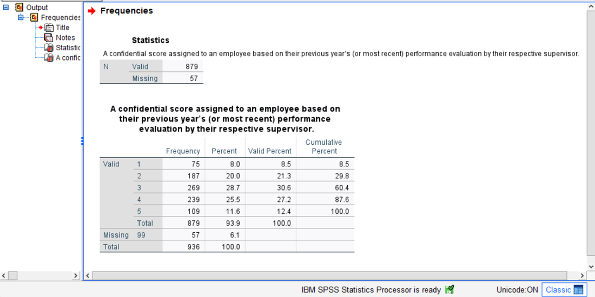{fig-alt="SPSS Output Viewer. A Statistics table shows N Valid 879 and Missing 57. The frequency table lists values 1 to 5 under Valid with a Total of 879, then 99 under Missing with 57, and a Total of 936."}

::: {.callout-warning}
## Gotcha: Missing says 0

If **N > Missing** is 0, the coding didn't work: SPSS is still counting 99 as a score. Go back to
the Missing cell and check what you typed.
:::

> When thinking about your own data's variables, how will missing values be coded?

## Coding values for categorical variables {#sec-values}

If you import a survey without defined Values for its categorical variables, you may need to
enter the value labels yourself. Evaluation has no labels yet: its Values cell says None.

::: callout-note
## In SPSS: label Evaluation's values

1. Look up Evaluation's values and labels in the codebook ([codebook ↑](#cb-evaluation)).
2. In **Variable View**, click the **Values** cell for **Evaluation**, then the **…** button to
   the right of the cell.
3. To code a new value, click the **+** button. Evaluation has 5 values, 1 through 5, so click
   it 5 times.
4. Enter the value and label for each: 1 is *poor*, 2 is *slightly underperformed*, 3 is *met
   expectations*, 4 is *slightly exceeded expectations* and 5 is *excellent*.
5. Click **OK**. The Values cell now shows the labels you entered.
:::

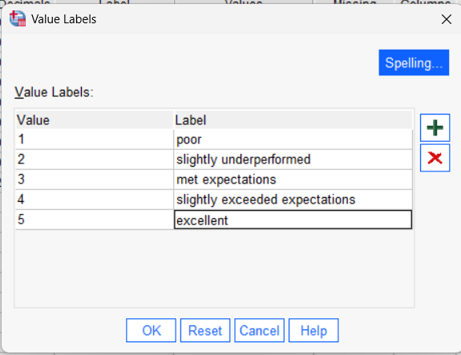{fig-alt="The Value Labels dialog. A table pairs values 1 to 5 with labels poor, slightly underperformed, met expectations, slightly exceeded expectations and excellent. A green plus and a red X button are to the right." width="55%"}

Now Variable View is informative and ready for further analysis.

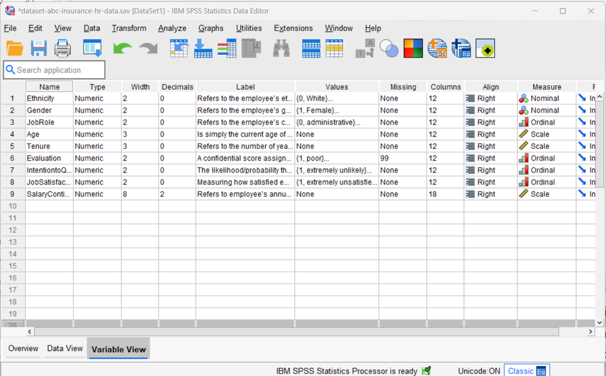{fig-alt="Variable View. Evaluation's row now shows {1, poor}... in Values, 99 in Missing and Ordinal in Measure. Gender is Nominal."}

------------------------------------------------------------------------

# Descriptive statistics {#sec-descriptive}

## Frequency of a categorical variable {#sec-freq-cat}

::: callout-note
## In SPSS: a frequency table and bar chart

1. Click **Analyze > Descriptive Statistics > Frequencies**.
2. Select one or more nominal or ordinal variables, such as **Evaluation** ([codebook ↑](#cb-evaluation)).
3. Click **Statistics**, select the options you want to see, and click **Continue**.
   - For a nominal variable like Gender, select **Mode** only.
   - For an ordinal variable like Evaluation, you can select **Mode**, plus **Quartiles** and
     **Range**.
4. To make a graph as well as a table, click **Charts**, select **Bar charts**, and click
   **Continue**.
5. Click **OK**.
:::

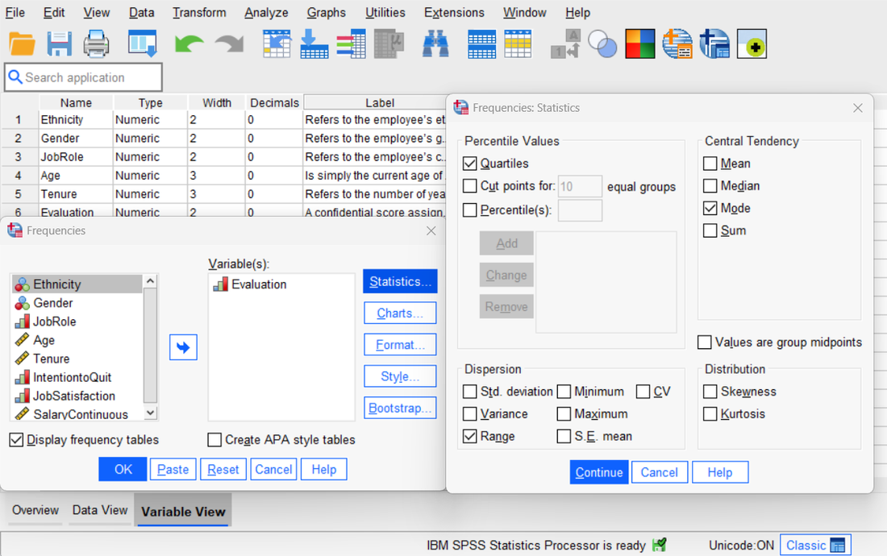{fig-alt="The Frequencies dialog with Evaluation selected, and the Frequencies: Statistics dialog beside it. Quartiles, Mode and Range are checked."}

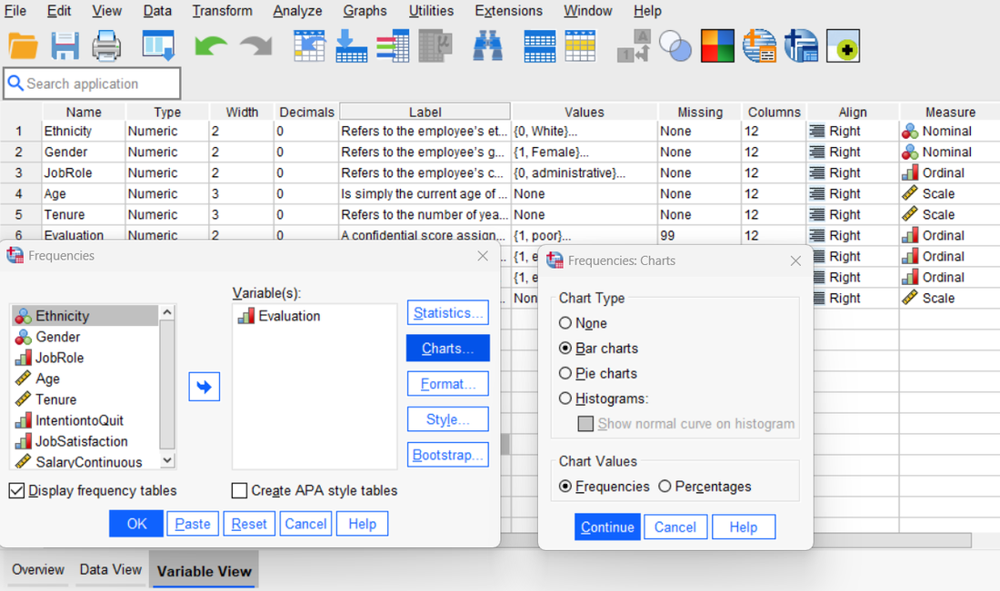{fig-alt="The Frequencies dialog with Evaluation selected, and the Frequencies: Charts dialog beside it. Bar charts is selected under Chart Type, and Frequencies under Chart Values."}

SPSS makes a frequency table for each variable you selected, with the statistics you chose, and a
bar chart of how often each category occurs.

By default, SPSS uses your variable's Label as the chart's title and horizontal axis title. For
Evaluation, that's a whole sentence.

::: callout-note
## In SPSS: retitle the chart

1. In the Output Viewer, double-click the chart to open the **Chart Editor**.
2. Double-click the horizontal axis title and change it to **Evaluation**.
3. Double-click the chart title and change it to **Frequency of Evaluation**.
4. Close the Chart Editor.
:::

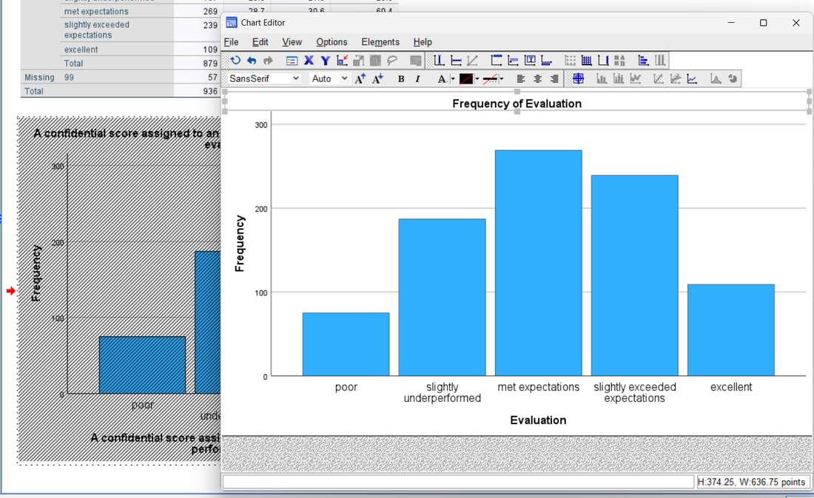{fig-alt="The SPSS Chart Editor open over the output. It shows a bar chart titled Frequency of Evaluation with Evaluation as the horizontal axis title. Bar heights rise from poor (about 75) to met expectations (about 270), then fall to excellent (about 110)."}

Because Evaluation has many missing values, use the **Valid Percent** column, not Percent, to see
each category's share. Percent divides by all 936 employees, including the 57 with no evaluation;
Valid Percent divides by the 879 who have one.

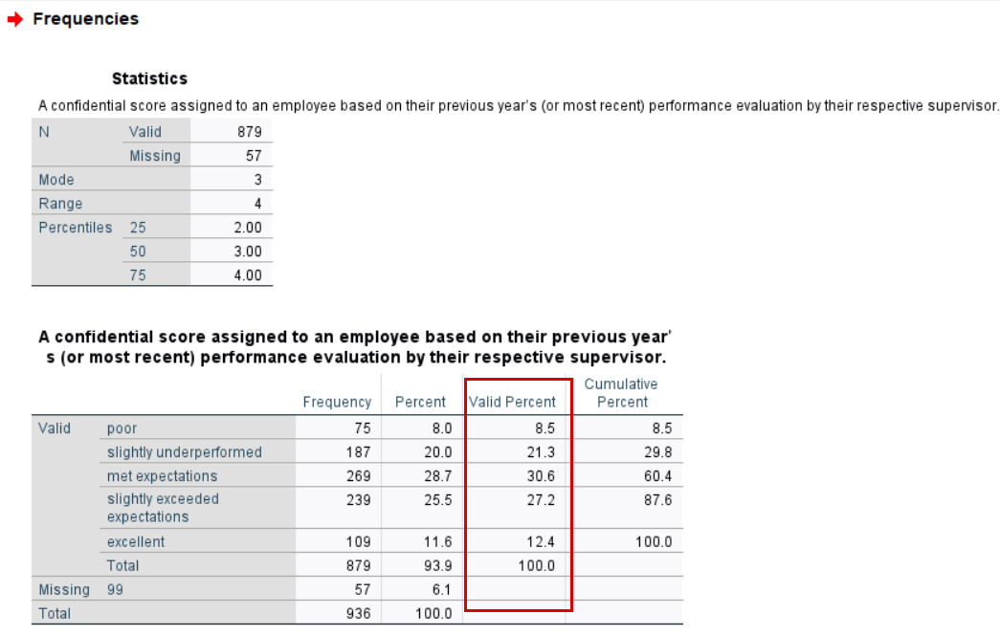{fig-alt="Frequencies output for Evaluation with labels. The Statistics table shows N Valid 879, Missing 57, Mode 3, Range 4, and percentiles 2, 3 and 4. A red box outlines the Valid Percent column of the frequency table: 8.5, 21.3, 30.6, 27.2, 12.4 and a total of 100.0."}

## Frequency of a scale variable {#sec-freq-scale}

::: callout-note
## In SPSS: summary statistics and a histogram

1. Click **Analyze > Descriptive Statistics > Frequencies**. Click **Reset** if Evaluation is
   still selected.
2. Select one or more scale variables, such as **Tenure** ([codebook ↑](#cb-tenure)).
3. Click **Statistics** and select the options you want under Percentile Values, Central
   Tendency, Distribution and Dispersion. Here we choose **Mean**, **Median** and **Mode** under
   Central Tendency, and **Std. deviation** and **Range** under Dispersion.
4. Click **Continue**.
5. To make a graph as well as a table, click **Charts**, select **Histograms**, check **Show
   normal curve on histogram**, and click **Continue**.
6. Uncheck **Display frequency tables**. A frequency table isn't helpful for a scale variable.
7. Click **OK**.
8. Rename the axis title and chart title as needed.
:::

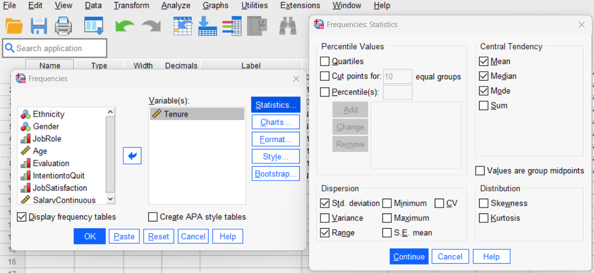{fig-alt="The Frequencies dialog with Tenure selected and the Frequencies: Statistics dialog beside it. Mean, Median and Mode are checked under Central Tendency, and Std. deviation and Range under Dispersion."}

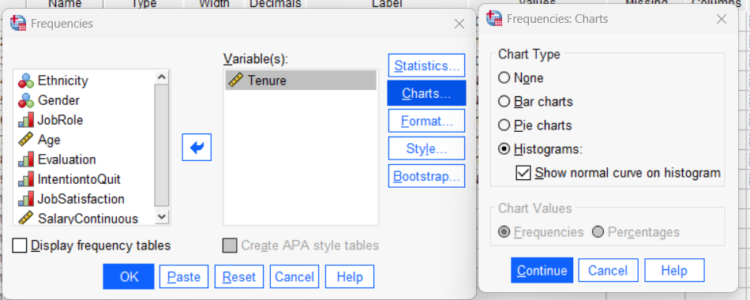{fig-alt="The Frequencies dialog with Tenure selected and Display frequency tables unchecked, and the Frequencies: Charts dialog beside it with Histograms and Show normal curve on histogram selected."}

You get a table of statistics and a histogram with a normal curve.

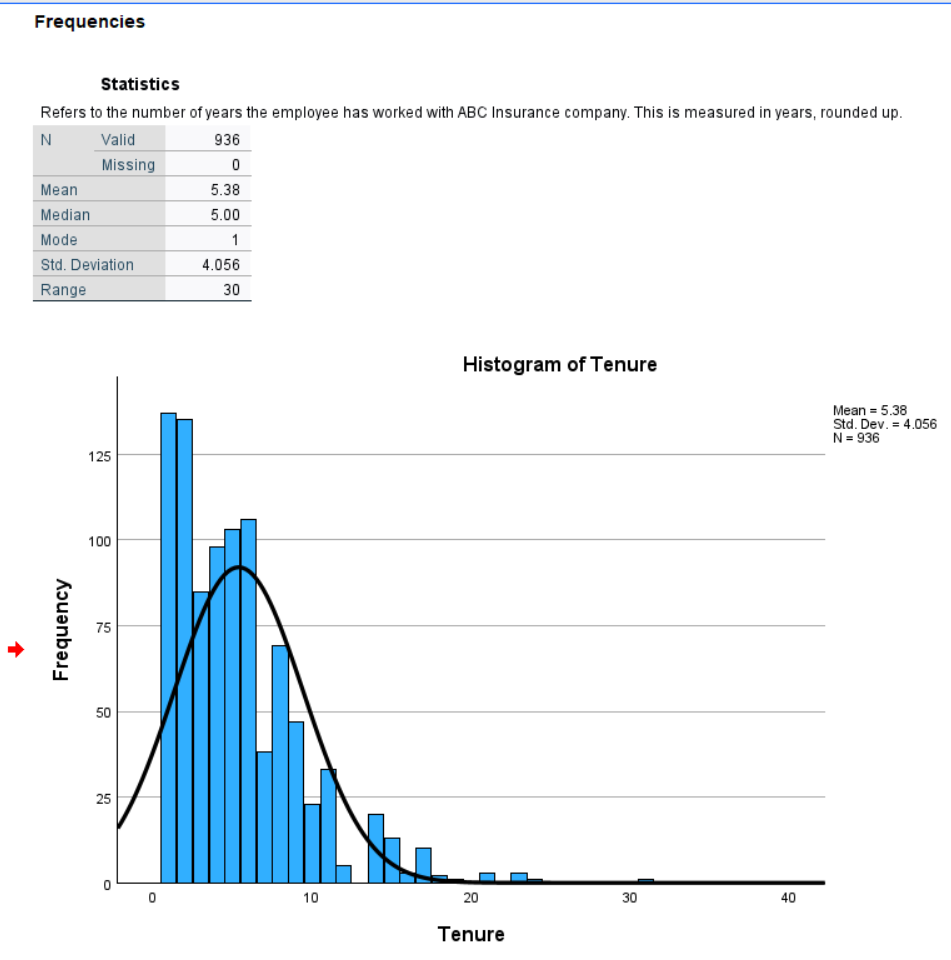{fig-alt="Output for Tenure. A Statistics table shows N 936, Mean 5.38, Median 5.00, Mode 1, Std. Deviation 4.056 and Range 30. Below, a histogram titled Histogram of Tenure has tall bars at 1 and 2 years that fall off to the right, with a long tail out to about 30 years. A normal curve centered near 5 is drawn over the bars."}

## Two categorical variables together {#sec-crosstabs}

**Cross-tabulations**, also known as crosstabs, show how often responses to two categorical
variables (nominal or ordinal) occur together. Each crosstab has a row variable and a column
variable: each row is a level of the row variable, and each column a level of the column
variable. To determine whether the two variables are associated, we can run a **chi-square
test**.

::: callout-note
## In SPSS: a crosstab with a chi-square test

1. Click **Analyze > Descriptive Statistics > Crosstabs**.
2. Move one categorical variable into **Row(s)** (**JobRole** ([codebook ↑](#cb-jobrole))) and one into
   **Column(s)** (**Gender** ([codebook ↑](#cb-gender))).
3. Click **Statistics**, select **Chi-square**, then click **Continue** and **OK**.
:::

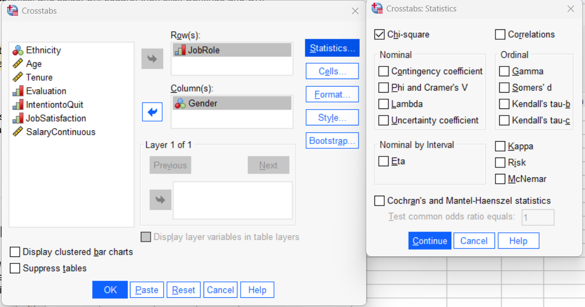{fig-alt="The Crosstabs dialog with JobRole in Row(s) and Gender in Column(s), and the Crosstabs: Statistics dialog beside it with Chi-square checked."}

The output is a crosstab and a chi-square test of independence between the two variables.

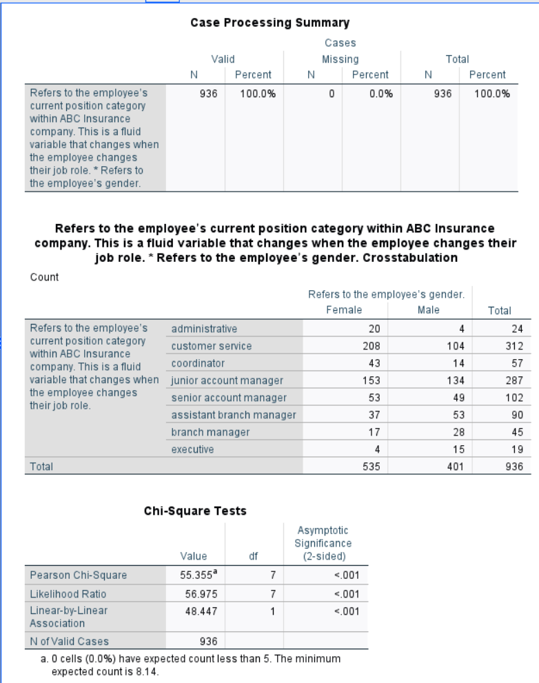{fig-alt="Crosstabs output. A table counts employees by job role and gender, from administrative (20 female, 4 male) to executive (4 female, 15 male), 535 female and 401 male in all. The Chi-Square Tests table shows Pearson Chi-Square 55.355 with 7 df and asymptotic significance below .001." width="75%"}

Look at the first row of the Chi-Square Tests table, Pearson Chi-Square. Its Asymptotic
Significance is below 0.05 (χ²(7) = 55.355, p < .001), so there is evidence that job role and
gender are associated.

------------------------------------------------------------------------

# Inferential statistics {#sec-inferential}

You can run any test in SPSS and receive output, but a variable **should** first be checked for
a normal distribution before you run an inferential test that assumes one. A normal distribution
forms a symmetrical, bell-shaped curve where most values cluster around a central average and
taper off equally on both sides. Normality testing applies to continuous variables only. In this
section we assume the data are normal; [Checking normality](#sec-normality) in the Appendix shows
how to test it with Explore.

## Correlation tables {#sec-correlation}

A correlation table shows the strength and direction of the relationships between pairs of
variables. The Pearson correlation requires two or more continuous variables.

The correlation coefficient (*r*) can be positive or negative, and ranges from −1 to 1:

- 0 means there is no relationship between the two variables.
- −1 means there is a perfect negative relationship.
- 1 means there is a perfect positive relationship.
- A positive coefficient means that as one variable increases, so does the other.
- A negative coefficient means that as one variable increases, the other decreases.

::: callout-note
## In SPSS: a Pearson correlation

1. Click **Analyze > Correlate > Bivariate**.
2. Move **Tenure** ([codebook ↑](#cb-tenure)) and **SalaryContinuous** ([codebook ↑](#cb-salarycontinuous)) into the
   **Variables** box.
3. Check **Pearson** under Correlation Coefficients.
4. Check **Flag significant correlations** to mark important results.
5. Click **OK** to run the test.
:::

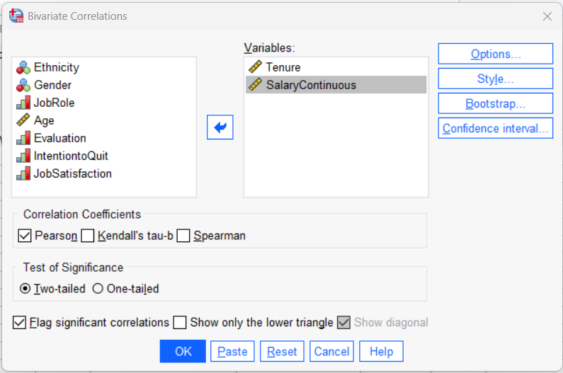{fig-alt="The Bivariate Correlations dialog with Tenure and SalaryContinuous in the Variables box. Pearson, Two-tailed and Flag significant correlations are checked." width="70%"}

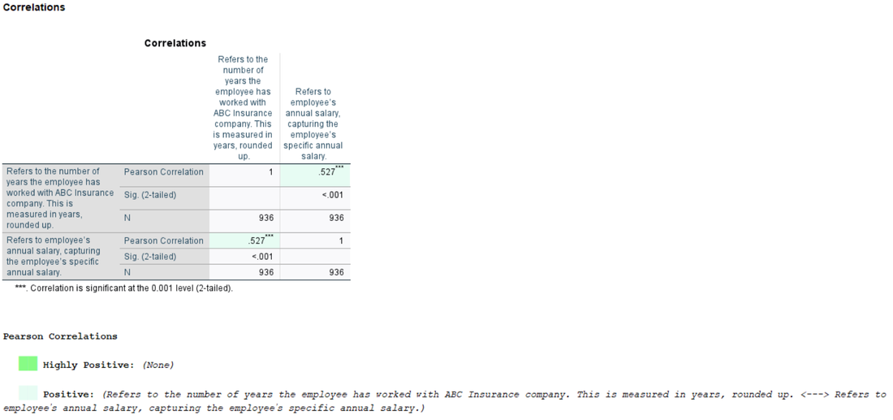{fig-alt="Correlations output. A two-by-two table pairs Tenure and SalaryContinuous; the Pearson correlation between them is .527, flagged with three asterisks, with Sig. (2-tailed) below .001 and N 936. A footnote says the correlation is significant at the 0.001 level."}

The correlation coefficient is .527, which suggests that Tenure and SalaryContinuous are
positively correlated. The three asterisks (\*\*\*) next to the coefficient mean it is
significant at the p < 0.001 level, as the footnote under the table says.

## Comparing means

The Independent-Samples T Test, One-Sample T Test and One-Way ANOVA compare means and determine
whether an observed difference is statistically significant.

- A **One-Sample T Test** compares a sample mean with a known value.
- An **Independent-Samples T Test** compares the means of two independent groups.
- A **One-Way ANOVA** compares the means of three or more groups.

All of these are under **Analyze > Compare Means and Proportions**. Here we use a one-way ANOVA to
illustrate the family. The [Appendix](#sec-appendix) shows the
[independent-samples t test](#sec-ttest) and the [one-sample t test](#sec-onesample).

### One-way ANOVA {#sec-anova}

ANOVA stands for ANalysis Of VAriance. A one-way ANOVA compares the means of two or more
independent groups to determine whether there is statistical evidence that the associated
population means are significantly different. You need two variables for this test:

- A **dependent variable** that is continuous (interval or ratio level).
- An **independent variable** that is categorical (two or more groups).

The null and alternative hypotheses of a one-way ANOVA are:

$$H_0: \mu_1 = \mu_2 = \mu_3 = \cdots = \mu_k \quad \text{(all } k \text{ population means are equal)}$$

$$H_1: \text{at least one } \mu_i \text{ is different} \quad \text{(at least one of the } k \text{ population means is not equal to the others)}$$

where $\mu_i$ is the population mean of the $i^{th}$ group, $i = 1, \dots, k$.

In the sample dataset, **SalaryContinuous** is an employee's annual salary
([codebook ↑](#cb-salarycontinuous)), and **JobRole** is the employee's current position within ABC Insurance
([codebook ↑](#cb-jobrole)). Let's use ANOVA to test whether salary
differs significantly by job role. SalaryContinuous is the dependent variable and JobRole is the
independent variable.

::: callout-note
## In SPSS: a one-way ANOVA

1. Click **Analyze > Compare Means and Proportions > One-Way ANOVA**.
2. Move your continuous dependent variable (**SalaryContinuous**) into the **Dependent List** box.
3. Move your categorical independent variable with three or more groups (**JobRole**) into the
   **Factor** box.
4. Click **OK**.
:::

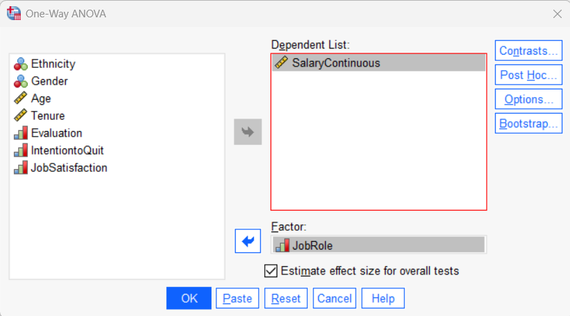{fig-alt="The One-Way ANOVA dialog with SalaryContinuous in the Dependent List and JobRole as the Factor. Estimate effect size for overall tests is checked." width="70%"}

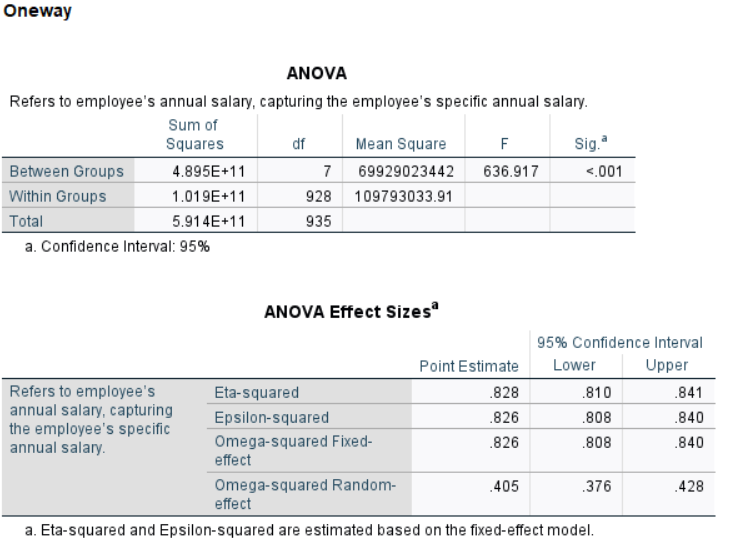{fig-alt="Oneway output. The ANOVA table shows Between Groups with 7 df and Within Groups with 928 df, F 636.917 and Sig. below .001. An ANOVA Effect Sizes table shows Eta-squared .828." width="70%"}

We conclude that mean salary differs significantly across at least one of the job roles
($F_{7,928} = 636.917,\ p < 0.001$). The ANOVA alone doesn't tell us *which* means differ. To
find out, follow up with multiple comparison (post hoc) tests, from the **Post Hoc** button in the
One-Way ANOVA dialog.

## Simple linear regression {#sec-regression}

Linear regression models the relationship between one independent ("explanatory") variable and a
dependent ("response") variable by analyzing many observations. The model can then be used to
predict and inform future behavior with a degree of statistical confidence. The equation for a
simple linear regression (SLR) is:

$$y = \beta_0 + \beta_1 x + \epsilon$$

where:

- $y$: the dependent variable
- $x$: the independent variable
- $\beta_0$: the intercept, the expected value of $y$ when $x = 0$
- $\beta_1$: the slope, how much $y$ is expected to change for every 1-unit increase in $x$
- $\epsilon$: the error term

In simple terms, if you plot a number of data points on a graph to see whether they form a
straight line, the SLR is the line of best fit for those points.

For example, we want to model and test whether Tenure ([codebook ↑](#cb-tenure)) predicts Salary
([codebook ↑](#cb-salarycontinuous)). The dependent variable is
SalaryContinuous and the independent variable is Tenure, so our model is:

$$\text{SalaryContinuous} = \beta_0 + \beta_1 \, \text{Tenure} + \epsilon$$

::: callout-note
## In SPSS: a simple linear regression

1. Go to **Analyze > Regression > Linear**.
2. Move **SalaryContinuous** into the **Dependent** box, and **Tenure** into the
   **Independent(s)** box.
3. Click **OK**.
:::

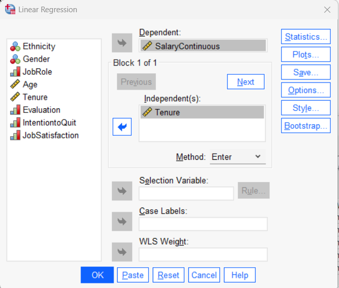{fig-alt="The Linear Regression dialog with SalaryContinuous as Dependent and Tenure in Independent(s). Method is Enter." width="60%"}

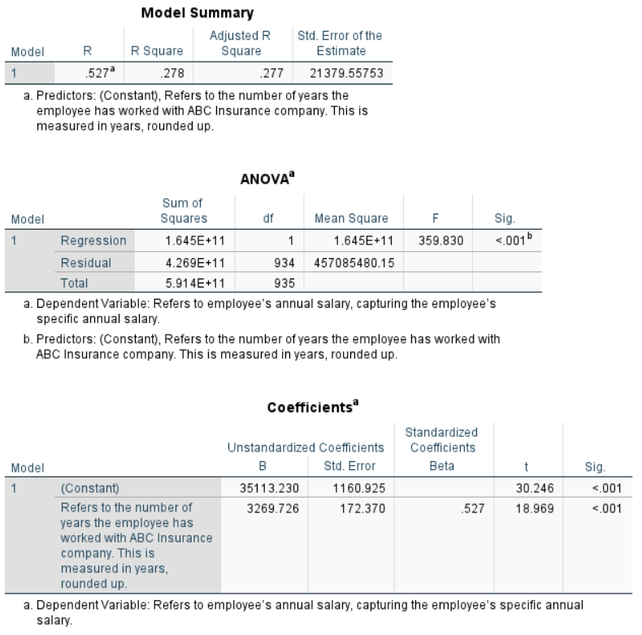{fig-alt="Regression output. The Model Summary shows R .527, R Square .278 and Adjusted R Square .277. The ANOVA table shows F 359.830 with Sig. below .001. The Coefficients table shows a constant of 35113.230 and a Tenure coefficient of 3269.726, with t 18.969 and Sig. below .001." width="70%"}

From the output:

- The **Adjusted R Square** is 0.277, which means that 27.7% of the variation in salary is
  explained by tenure.
- The **coefficient of Tenure** is 3269.726, which means that for each additional year of tenure
  at ABC Insurance, an employee's predicted salary increases by \$3,269.73, on average.

Our conclusion: the p-value for Tenure is < 0.001, so tenure is a statistically significant
predictor of salary.

------------------------------------------------------------------------

# Exporting output {#sec-export}

Once you've run the analyses you're interested in, you can export them to a document file.

::: callout-note
## In SPSS: export your results

1. To export only one or a few output items, select them in the Output Viewer so they're
   highlighted. To export all the output since you opened SPSS, skip to the next step.
2. In the Output Viewer, right-click and select **Export**, or go to **File > Export**.
3. At the top of the Export Output window, **All** exports every analysis you ran in this
   session; **Selected** exports only the items you highlighted.
4. The **Type** dropdown under Document sets the document format. The default is Word
   (.docx); you can also choose PDF and other formats.
5. To export graphics instead, choose **None (Graphics only)** as the Document type, then pick
   a format under **Graphics**.
6. Click **Browse** to choose the folder to save to, then click **OK**.
:::

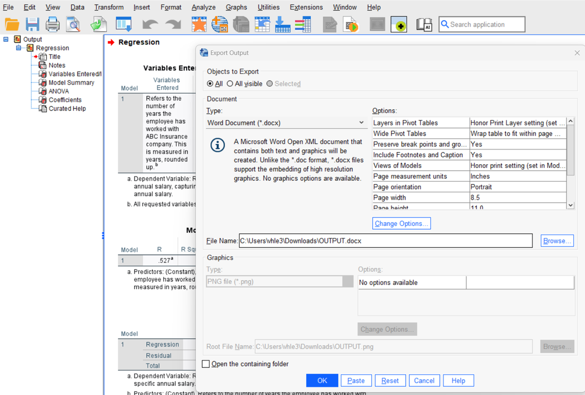{fig-alt="The Export Output window open over the Output Viewer. Objects to Export is set to All, Document Type is Word Document (*.docx), and the File Name is a path in the Downloads folder."}

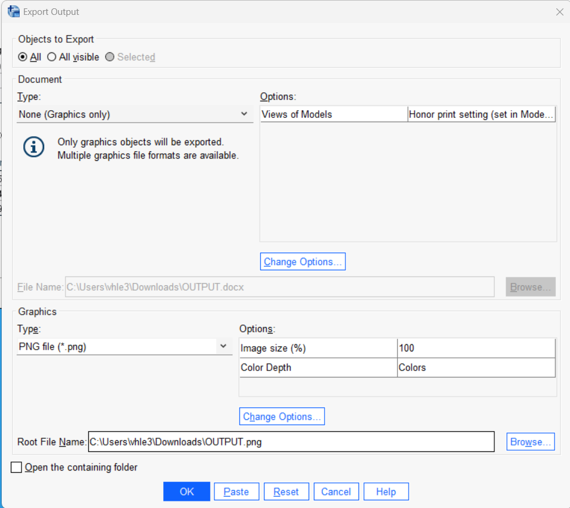{fig-alt="The Export Output window with Document Type set to None (Graphics only). Under Graphics, Type is PNG file (*.png), with a root file name in the Downloads folder." width="70%"}

::: {.callout-warning}
## Gotcha: save to Google Drive, not just the VCL

If you save your output on the VCL, move it into Google Drive (or other cloud storage) before
you leave, so you can get to it from outside the VCL.
:::

## Save your files and leave the VCL

::: callout-note
## In the VCL: save to the cloud and log off

1. [In the VCL's web browser, go to [drive.google.com](https://drive.google.com), sign in with
   your NC State account, and upload your output files and any data you changed.]{.tbd}
2. [Double-click **Log Off** on the VCL desktop to end your session.]{.tbd}
:::

------------------------------------------------------------------------

# SPSS resources {#sec-resources}

- **Get NC State in-person access and live help with SPSS:**
  [go.ncsu.edu/getdatahelp](http://go.ncsu.edu/getdatahelp)
  - The Data Experience Lab on the 3rd floor of Hill Library has computers with SPSS installed
    (instead of using the VCL).
  - Consultations with an expert on how to use SPSS for your specific project.
- **Official IBM tutorial:**
  [ibm.com/docs/en/spss-statistics/25.0.0?topic=tutorial](https://www.ibm.com/docs/en/spss-statistics/25.0.0?topic=tutorial).
  A thorough walkthrough of SPSS.
- **Help with specific techniques:** how2stats ([how2statsbook.com](https://www.how2statsbook.com)).
  - Short [YouTube videos](https://www.youtube.com/user/how2stats/about) focused on explaining
    specific tasks.
- **Video training on LinkedIn Learning:**
  [SPSS Statistics Essential Training](https://www.linkedin.com/learning/spss-statistics-essential-training-2/navigating-spss?autoplay=true&resume=false&u=53565897).
  - NC State students have access to LinkedIn Learning, which is also useful for learning other
    topics, with thousands of videos on software, business and more.
- **Online book-style tutorial:** [UCLA OARC SPSS modules](https://stats.idre.ucla.edu/spss/modules/).
  - Focuses more on syntax (code) than on the point-and-click interface. SPSS syntax opens up
    custom analyses and data processing.
- **Asynchronous library guide tutorial:** [Kent State University Libraries, SPSS
  Tutorials](https://libguides.library.kent.edu/SPSS/home).
  - A sample walkthrough with a provided dataset. It also covers multiple response sets (for
    "select all that apply" questions) and recoding missing values.

## References {#sec-references .unnumbered}

**The data.** Arseneault, R. (2023). *Learn to use descriptive statistics in SPSS to interrogate
large employee HR data sets with simulated company data*. In *Sage Research Methods: Business*.
SAGE Publications Ltd. <https://doi.org/10.4135/9781529629477>. NC State students and staff:
[open it through NC State Libraries](https://methods-sagepub-com.prox.lib.ncsu.edu/dataset/descriptive-stats-hr-data-spss).

Kent State University Libraries. (2017, May 15). *SPSS Tutorials*. Retrieved September 24, 2026,
from <https://libguides.library.kent.edu/SPSS>

------------------------------------------------------------------------

# Appendix {#sec-appendix .unnumbered}

## Checking normality {#sec-normality .unnumbered}

You *can* run any test in SPSS and receive output, but a variable should first be checked for a
normal distribution before you run an inferential test that assumes one. Normality testing
applies to continuous variables only.

::: callout-note
## In SPSS: test for normality with Explore

1. Click **Analyze > Descriptive Statistics > Explore**.
2. Move a scale variable, such as **SalaryContinuous** ([codebook ↑](#cb-salarycontinuous)), to the
   **Dependent List**. Click the
   **Plots** button.
3. In the Plots dialog, check **Normality plots with tests**. This adds the Shapiro-Wilk and
   Kolmogorov-Smirnov tests and Q-Q plots.
4. Click **Continue** to return to the main dialog.
5. Click **OK**.
:::

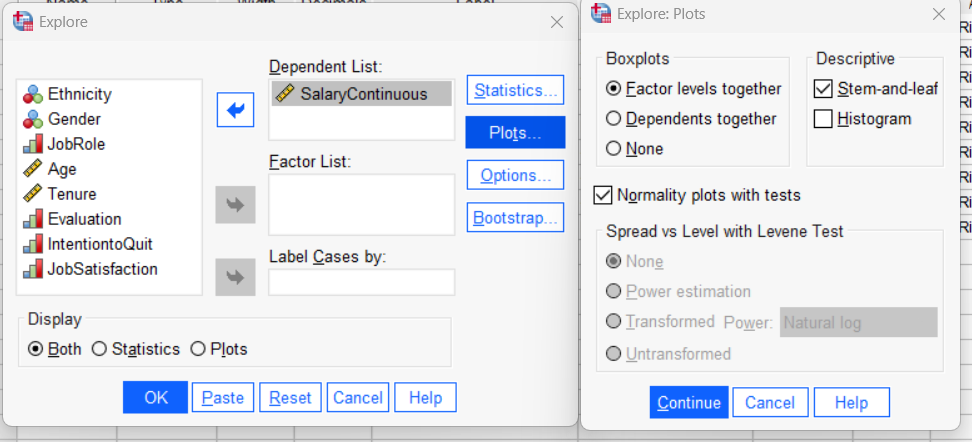{fig-alt="The Explore dialog with SalaryContinuous in the Dependent List, and the Explore: Plots dialog beside it with Normality plots with tests checked." width="85%"}

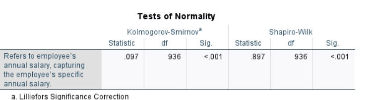{fig-alt="Tests of Normality for SalaryContinuous. Kolmogorov-Smirnov: statistic .097, df 936, Sig. below .001. Shapiro-Wilk: statistic .897, df 936, Sig. below .001." width="70%"}

Check the **Sig.** value in the Shapiro-Wilk columns of the Tests of Normality table. If it is
greater than 0.05, there's no evidence that the data depart from a normal distribution. If it is
below 0.05, the data significantly deviate from a normal distribution.

In our example, SalaryContinuous isn't normally distributed: the Sig. value is < .001, and the
Q-Q plot shows a heavy tail.

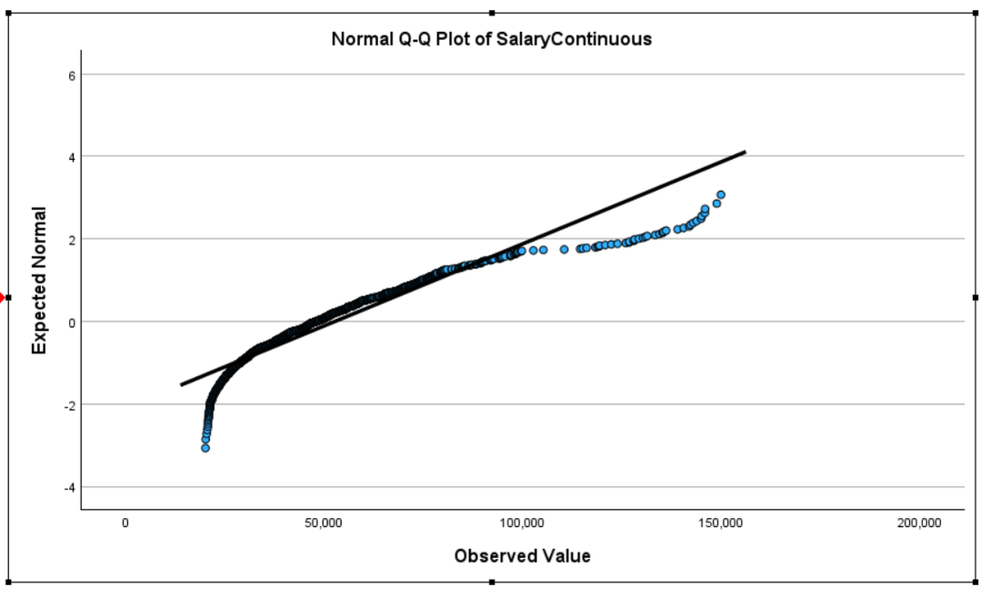{fig-alt="A Normal Q-Q Plot of SalaryContinuous, Expected Normal against Observed Value. The points follow the straight line in the middle, but bend away sharply below it at the low end, near 20,000, and flatten below it at the high end, from about 100,000 to 150,000."}

## Independent-samples t test {#sec-ttest .unnumbered}

One question we might ask is whether average tenure is different for male and female employees.
That means testing whether the sample means of tenure for men and women are statistically
different, which an independent-samples t test does.

An independent-samples t test tells you whether there is a difference between the means of two
groups on a particular variable. The dependent variable (**Test Variable**) must be continuous
(interval or ratio level), and the independent variable (**Grouping Variable**) must be
categorical (nominal or ordinal) with exactly two categories.

The hypotheses for our question are:

$$H_0: \mu_{Male} - \mu_{Female} = 0 \quad \text{(the difference of the means is equal to zero)}$$

$$H_1: \mu_{Male} - \mu_{Female} \neq 0 \quad \text{(the difference of the means is not equal to zero)}$$

where $\mu_{Male}$ and $\mu_{Female}$ are the population means for men and women.

::: callout-note
## In SPSS: an independent-samples t test

1. Click **Analyze > Compare Means and Proportions > Independent-Samples T Test**.
2. Move a quantitative variable into **Test Variable(s)**, such as **Tenure** ([codebook ↑](#cb-tenure)). This is the
   dependent variable.
3. Move a categorical variable into **Grouping Variable**, such as **Gender**. This is the
   independent variable.
4. Click **Define Groups** and fill in the codes for the two categories you want to compare.
   Female is 1 and male is 2 ([codebook ↑](#cb-gender)), so put **1** in Group 1 and **2** in Group 2. Click **Continue**.
5. Check **Homogeneity of variance test**, so the output includes Levene's test.
6. Click **Options** and check that the Confidence Interval Percentage is **95**. That means your
   alpha (what you compare your p-value to for statistical significance) is 0.05 (5%). Click
   **Continue**.
7. Click **OK**.
:::

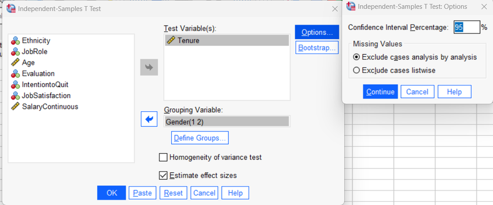{fig-alt="The Independent-Samples T Test dialog with Tenure as the Test Variable and Gender(1 2) as the Grouping Variable. Homogeneity of variance test is unchecked and Estimate effect sizes is checked. The Options dialog beside it shows a 95 percent Confidence Interval Percentage."}

::: placeholder
**Screenshot to take: `images/ttest-output-levene.png`.** The Independent Samples Test table
after running the test with **Homogeneity of variance test** checked, so the Levene's Test for
Equality of Variances columns (F and Sig.) show. It replaces the screenshot below.
:::

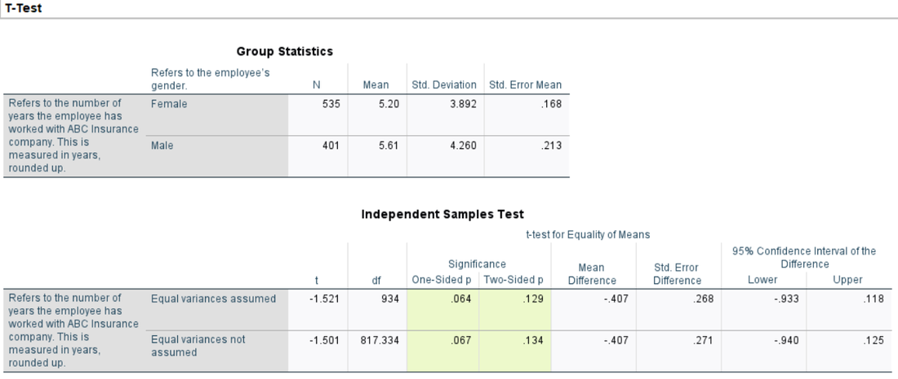{fig-alt="T-Test output. Group Statistics: 535 female employees with mean tenure 5.20, and 401 male with mean 5.61. The Independent Samples Test table has two rows. Equal variances assumed: t -1.521, df 934, one-sided p .064, two-sided p .129, mean difference -.407. Equal variances not assumed: t -1.501, df 817.334, two-sided p .134."}

### Reading the output {.unnumbered}

**Which row of the Independent Samples Test table do we read?** That depends on Levene's test,
which checks whether equal variances can be assumed. If Levene's **Sig.** is greater than 0.05,
use the first row, *Equal variances assumed*. If it is below 0.05, equal variances can't be
assumed, so use the second row, *Equal variances not assumed*.

**Is the difference significant?** In the row you chose, read the **Two-Sided p**. If it is
smaller than 0.05, reject the null hypothesis. If it is greater than 0.05, fail to reject the null
hypothesis: the difference between the two groups on this dependent variable is not
statistically significant. Here the two-sided p is .129 (or .134 in the second row), so there's
no significant difference in mean tenure between female and male employees.

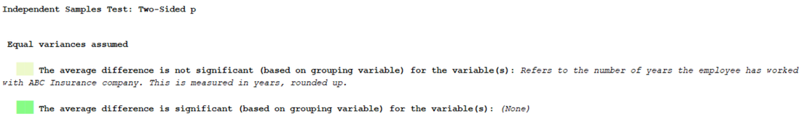{fig-alt="A note from SPSS titled Independent Samples Test: Two-Sided p. Under Equal variances assumed, a pale green swatch says the average difference is not significant for the tenure variable, and a bright green swatch says the average difference is significant for no variables."}

**What is the Independent Samples Effect Sizes table?** It shows the effect size, which is also
useful, for example, when estimating an appropriate sample size for a study. Find it in the
**Point Estimate** column of the **Cohen's d** row. As a rule of thumb, a d of about 0.2 is a
small effect, about 0.5 a medium effect, and 0.8 or more a large effect. Here d is −0.100, a
negligible effect.

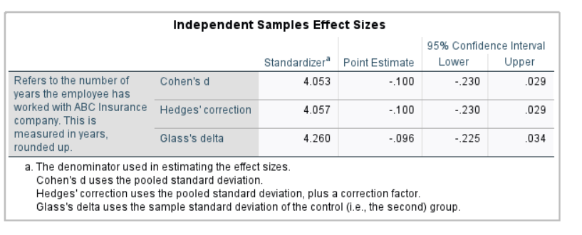{fig-alt="Independent Samples Effect Sizes table for tenure. Cohen's d: standardizer 4.053, point estimate -.100, 95 percent confidence interval -.230 to .029. Hedges' correction and Glass's delta give similar values." width="75%"}

**What values are standard to include in a report?**

- *N* (sample size)
- Mean
- *SD* (standard deviation)
- *t* (the t statistic)
- *df* (degrees of freedom). For an independent-samples t test with equal variances assumed, it's
  the two group sizes added together, minus 2 (535 + 401 − 2 = 934). The *Equal variances not
  assumed* row uses an adjusted df.
- Two-sided *p* (the p-value for that t and df)

## One-sample t test {#sec-onesample .unnumbered}

A one-sample t test tells you whether a sample mean is statistically different from a population
value. The test variable must be continuous (interval or ratio level).

According to the [Bureau of Labor Statistics](https://www.bls.gov/news.release/pdf/tenure.pdf),
the *median* number of years that wage and salary workers had been with their current employer
was 4.1 years in January 2026. We want to test whether the sample mean of Tenure is significantly
different from 4.1 with a one-sample t test.

The null and alternative hypotheses are:

$$H_0: \mu_{Tenure} = 4.1 \quad \text{(the mean Tenure is equal to 4.1)}$$

$$H_1: \mu_{Tenure} \neq 4.1 \quad \text{(the mean Tenure is not equal to 4.1)}$$

where $\mu_{Tenure}$ is the mean tenure.

::: callout-note
## In SPSS: a one-sample t test

1. Click **Analyze > Compare Means and Proportions > One-Sample T Test**.
2. Move your continuous test variable, such as **Tenure** ([codebook ↑](#cb-tenure)), into the
   **Test Variable(s)** box.
3. Type your target number, **4.1**, into the **Test Value** box.
4. Click **OK** to run the test.
:::

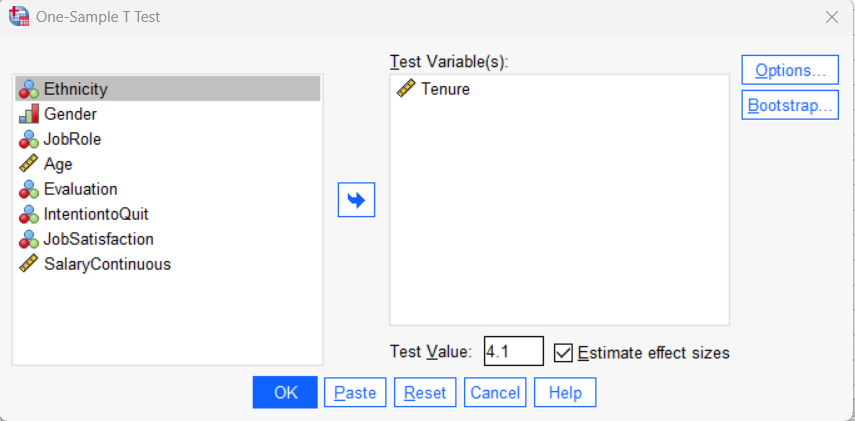{fig-alt="The One-Sample T Test dialog with Tenure in Test Variable(s), a Test Value of 4.1, and Estimate effect sizes checked." width="70%"}

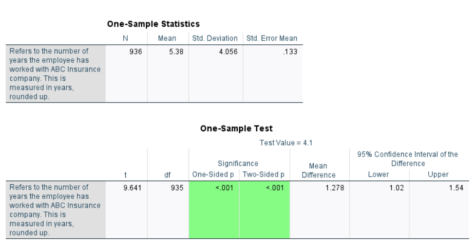{fig-alt="One-Sample Statistics for tenure: N 936, mean 5.38, standard deviation 4.056. One-Sample Test with Test Value 4.1: t 9.641, df 935, one- and two-sided p below .001, mean difference 1.278, 95 percent confidence interval 1.02 to 1.54." width="80%"}

Since p < 0.001, we reject the null hypothesis that the mean tenure of employees at this company
equals the hypothesized population value of 4.1 years, and conclude that mean tenure is
significantly different from 4.1 years.

Based on the results, we can state:

> There is a significant difference between the mean tenure of employees at this company and the
> overall employee population in the U.S. (p < .001). The average tenure of employees at this
> company is about 1.278 years more than the U.S. employee population average (95% CI [1.02,
> 1.54]).
